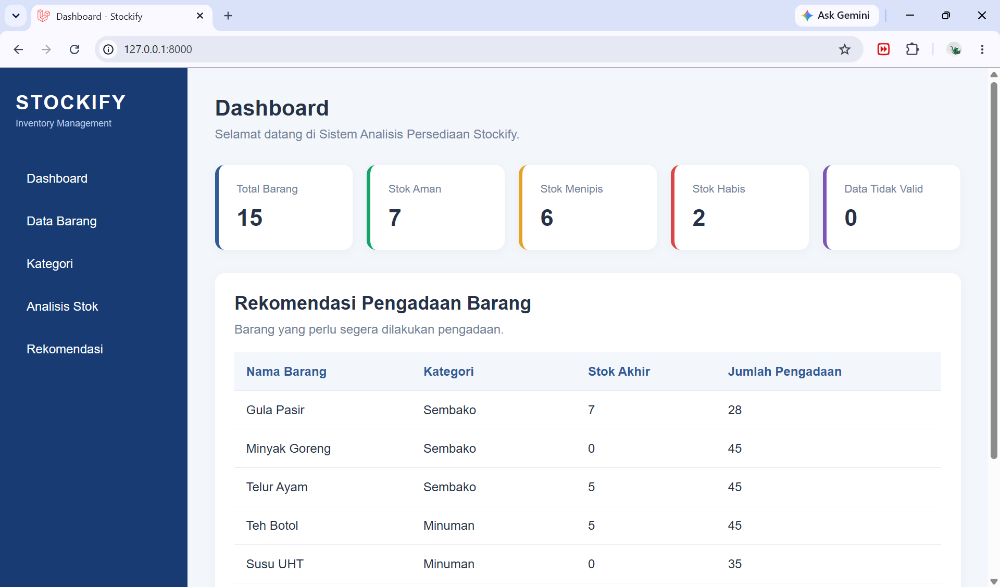
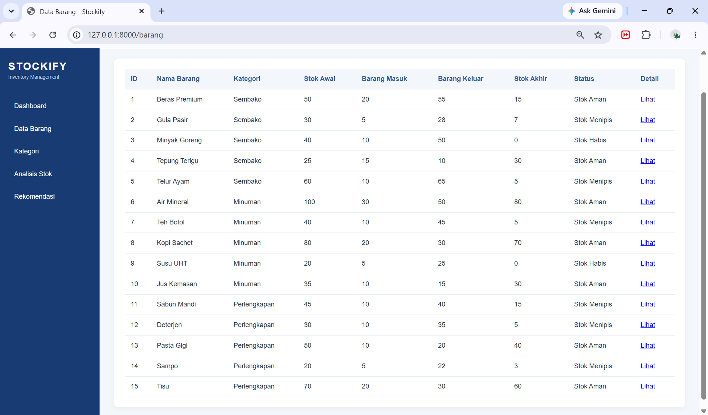
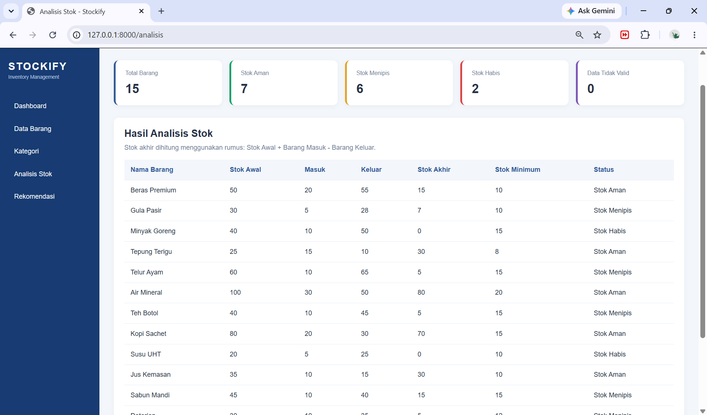
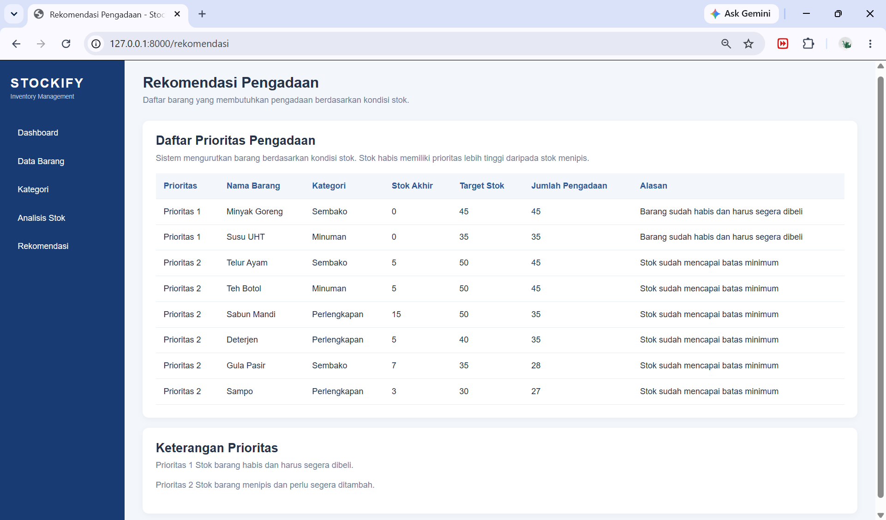

# STOCKIFY
### Sistem Analisis Persediaan dan Rekomendasi Pengadaan Barang

Stockify merupakan aplikasi berbasis web yang dibuat menggunakan Laravel untuk membantu pengelolaan persediaan barang. Aplikasi ini dapat menghitung stok akhir, menganalisis kondisi persediaan, dan memberikan rekomendasi pengadaan barang.

## Identitas
- Nama: Heru Rujhanul M.
- NIM: C2483207014
- Program Studi: Pendidikan Teknologi Informasi
- Kelas: PTI 5
- Mata Kuliah: Pemrograman Internet

## Teknologi
- Laravel
- PHP
- HTML
- CSS
- Blade Template

## Fitur Aplikasi
1. Dashboard persediaan barang.
2. Menampilkan minimal 15 data barang.
3. Pengelompokan barang berdasarkan kategori.
4. Detail informasi barang.
5. Perhitungan stok akhir.
6. Analisis stok aman, menipis, dan habis.
7. Pemeriksaan data persediaan tidak valid.
8. Rekomendasi dan prioritas pengadaan barang.

## Rumus Perhitungan

Stok Akhir = Stok Awal + Barang Masuk - Barang Keluar

Kebutuhan Pengadaan = Target Stok - Stok Akhir

## Screenshot Aplikasi

### Dashboard

### Data Barang

### Analisis Stok

### Rekomendasi Pengadaan

## Cara Menjalankan
1. Clone repository.
2. Jalankan composer install.
3. Salin file .env.example menjadi .env.
4. Jalankan php artisan key:generate.
5. Jalankan php artisan serve.
6. Buka http://127.0.0.1:8000.

## Keterangan
Aplikasi menggunakan data PHP array dan tidak menggunakan database untuk penyimpanan data barang.
